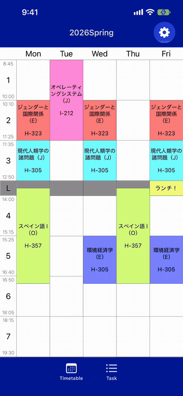
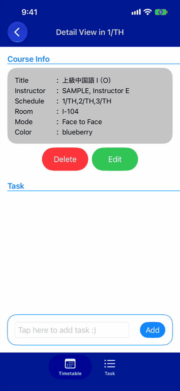
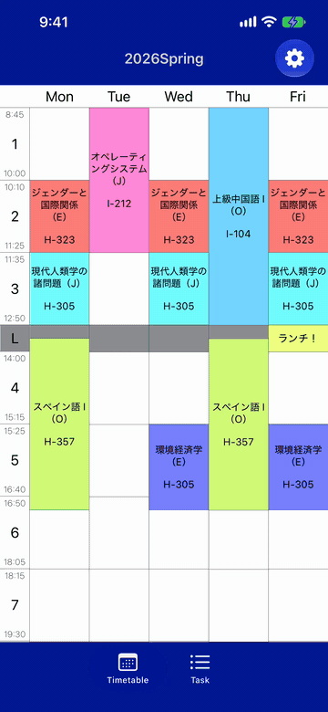

# Timetable4ICU

Timetable4ICU is a timetable app for students at International Christian University (ICU). Pick your courses from the ICU syllabus, see your week at a glance, and keep track of assignments for each course.

  

[Download on the App Store](https://apps.apple.com/jp/app/timetable4icu/id1605478409) · [Website](https://www.timetable4icu.com)

## Features

- **Syllabus built in:** Tap an empty period to see every course offered in it, then search by title, course number, or instructor. Syllabus data covers academic years 2020 through 2026.
- **Overlap warnings:** Courses that clash with ones already in your timetable are labeled with the names of those courses before you add them.
- **Multi-period courses:** Picking a course fills every period it meets in, and consecutive periods are joined into one block. Each course can have its own color.
- **Assignments:** Add tasks from a course's detail screen and see tasks from all courses in the Task tab.
- **Your layout:** Show Saturday, 8th period, and class start and end times as you like. Times follow the class schedule of the timetable's year (the 2025 schedule change is handled).
- **Multiple timetables:** Keep one timetable per term and switch between them in Settings.

Trusted by approximately 70% of ICU students, about 2,600 users.

## Screens

<table>
  <tr>
    <td align="center" width="33%">
       
      <b>Add a course</b> 
      Choose from the syllabus for that period, with overlaps shown up front.
    </td>
    <td align="center" width="33%">
       
      <b>Track assignments</b> 
      Add tasks to a course and review them all in the Task tab.
    </td>
    <td align="center" width="33%">
       
      <b>Adjust the layout</b> 
      Turn on Saturday and 8th period when you need them.
    </td>
  </tr>
</table>

Instructor names in these recordings are placeholders.

## Requirements

- iOS 16.0 or later
- Xcode (recent version) to build

## Development

1. Open `timetable.ver5.xcodeproj` in Xcode. Swift Package Manager fetches the dependencies ([Realm](https://github.com/realm/realm-swift) and [PartialSheet](https://github.com/AndreaMiotto/PartialSheet)).
2. Generate the syllabus files with [SyllabusScraper](https://github.com/kohshi54/SyllabusScraper) and put them in `timetable.ver5/` as `ALL<year>.txt` (for example `ALL2026.txt`).
   - The syllabus requires an ICU login, so these files are **not** committed to this repository (`.gitignore` excludes them).
   - Without them the app still builds and runs, but the course list only shows a placeholder entry.
3. Build and run on a simulator or device.

## Built with

- Swift, SwiftUI
- Realm Database
- Python (syllabus scraper)

## Related repositories

- [SyllabusScraper](https://github.com/kohshi54/SyllabusScraper): collects course data from the ICU syllabus
- [timetable.ver5](https://github.com/kohshi54/timetable.ver5): source code of an earlier version
